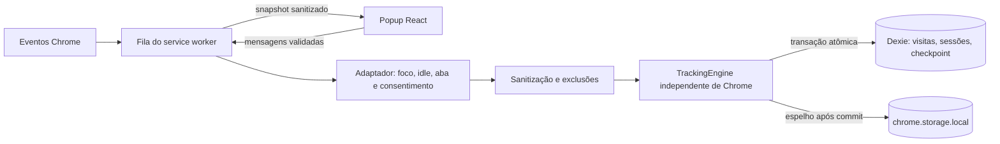

# Arquitetura

## Fluxo

Os listeners são registrados sincronamente no topo de `src/background/index.ts`. Ativação, atualização/fechamento de abas, foco, idle, startup, instalação e alarme entram na fila. A inicialização restringe storage a contextos confiáveis e recria o alarme, pois sua persistência não deve ser presumida. Cada reconciliação consulta configurações, idle, janela em foco e aba ativa. Mudança de URL força outra visita; uma URL ainda indisponível não é capturada e pode se tornar elegível no próximo evento.

Eventos de foco perdido e idle/locked interrompem o período independentemente de consultas subsequentes. O fechamento impede retomar a aba removida. Atualizações de URL repetidas são deduplicadas por digest SHA-256 em memória, sem reter as URLs originais. Eventos repetidos sem mudança de estado não criam novas visitas. O tempo é aplicado apenas entre checkpoints crescentes e confirmados; uma repetição no mesmo instante soma zero.

O popup só lê/escreve através de mensagens do mesmo ID de extensão e URL exata de popup. Comandos permitidos: snapshot, toggle, exclude e clear. As configurações são validadas, nunca é aceito um objeto de configurações arbitrário da interface. O motor também serializa chamadas para ser testável isoladamente.

## Modelo

- **Visit**: UUID, sessão, aba/janela, domínio, origem sanitizada, título substituído pelo domínio, início/fim UTC, duração ativa acumulada e status active/completed/interrupted.
- **BrowsingSession**: UUID, início/fim UTC, tempo acumulado, quantidade de visitas e status active/completed.
- **TrackingSettings**: consentimento (false inicialmente), idle (60 s), timeout (20 min), lista de exclusões. Persistido em storage.local.
- **Checkpoint**: chave única tracking, UUID do período, visita e sessão correntes, último instante observado e último instante de atividade elegível. Canônico no IndexedDB e espelhado em storage.local. Sem URL ou título.

Índices de visitas: ID, sessão, início e domínio. Sessões: ID e início. O período identifica uma visita contínua; ao interromper, o ID é descartado. Datas são ISO 8601 UTC; duração é numérica e não negativa. Os intervalos são `[startedAt, endedAt)`.

## Consistência e recuperação

1. A transação lê o checkpoint canônico.
2. Se a instância do motor for nova, fecha a visita em seu último checkpoint com status interrupted. Não soma o intervalo desde a última execução.
3. Se a instância continuar e o intervalo for até 45 s, aplica apenas o delta não confirmado à visita e sessão. Saltos longos interrompem no último checkpoint.
4. Mudança de elegibilidade, aba, janela ou URL fecha o período. Uma nova visita só começa se a captura estiver autorizada e elegível.
5. Após 20 minutos sem atividade elegível, fecha a sessão no último instante ativo. Startup do navegador também encerra a sessão anterior.
6. Grava visitas, sessões e checkpoint atomicamente. Só depois espelha o checkpoint no Chrome storage. Uma falha nesse espelho não reverte o commit nem altera a fonte de verdade.

Exclusão roda na mesma fila de eventos: primeiro persiste consentimento desativado, depois remove todas as entidades e limpa o espelho. Mesmo após interrupção entre essas operações, não há retomada automática da captura. Um erro é informado no popup; o usuário pode repetir a exclusão.

## Limites

Alarmes não são um cronômetro preciso. O ciclo de vida MV3 pode matar o worker após inatividade; o motor escolhe descartar o tempo não observado mesmo que seja navegação legítima. O limiar de 45 s não garante detectar toda suspensão curta. O relógio civil pode mudar: retrocessos são limitados pelo último checkpoint, avanços longos são descartados; ajustes pequenos permanecem indistinguíveis de tempo real. Metadados consultados assincronamente podem refletir a aba mais recente durante alternâncias rápidas, com perda de visitas muito breves. Não é uma auditoria exata de atenção humana.

Referência oficial consultada: [ciclo de vida do service worker](https://developer.chrome.com/docs/extensions/develop/concepts/service-workers/lifecycle/). A documentação descreve encerramento por inatividade e alarmes de período mínimo de 30 s a partir de Chrome 120.

O popup consulta o histórico completo para calcular o resumo e limita apenas a apresentação às dez últimas visitas. Históricos muito grandes precisarão de agregação/paginação na próxima fase. O dado local não é criptografado pela extensão; permanece sujeito à proteção do perfil do navegador e do dispositivo.
